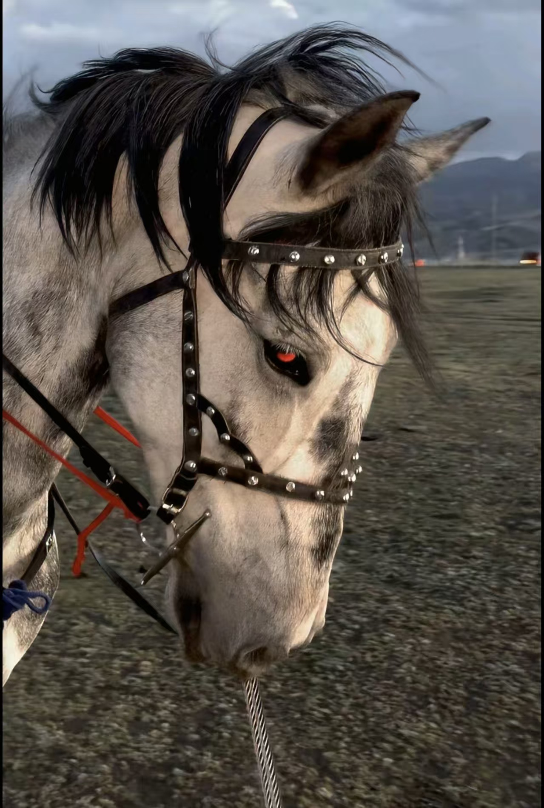
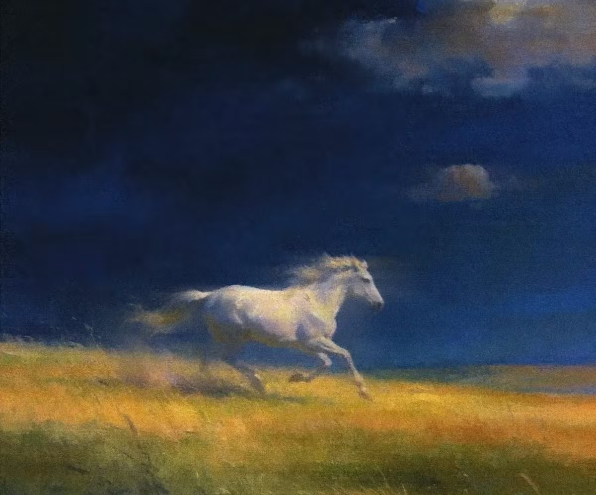
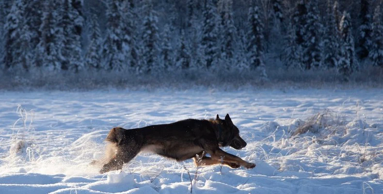
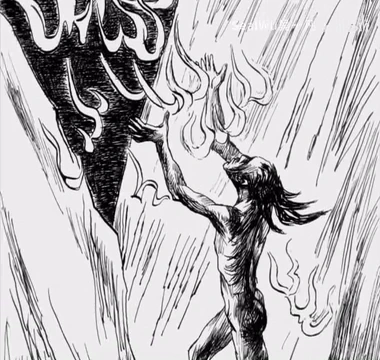
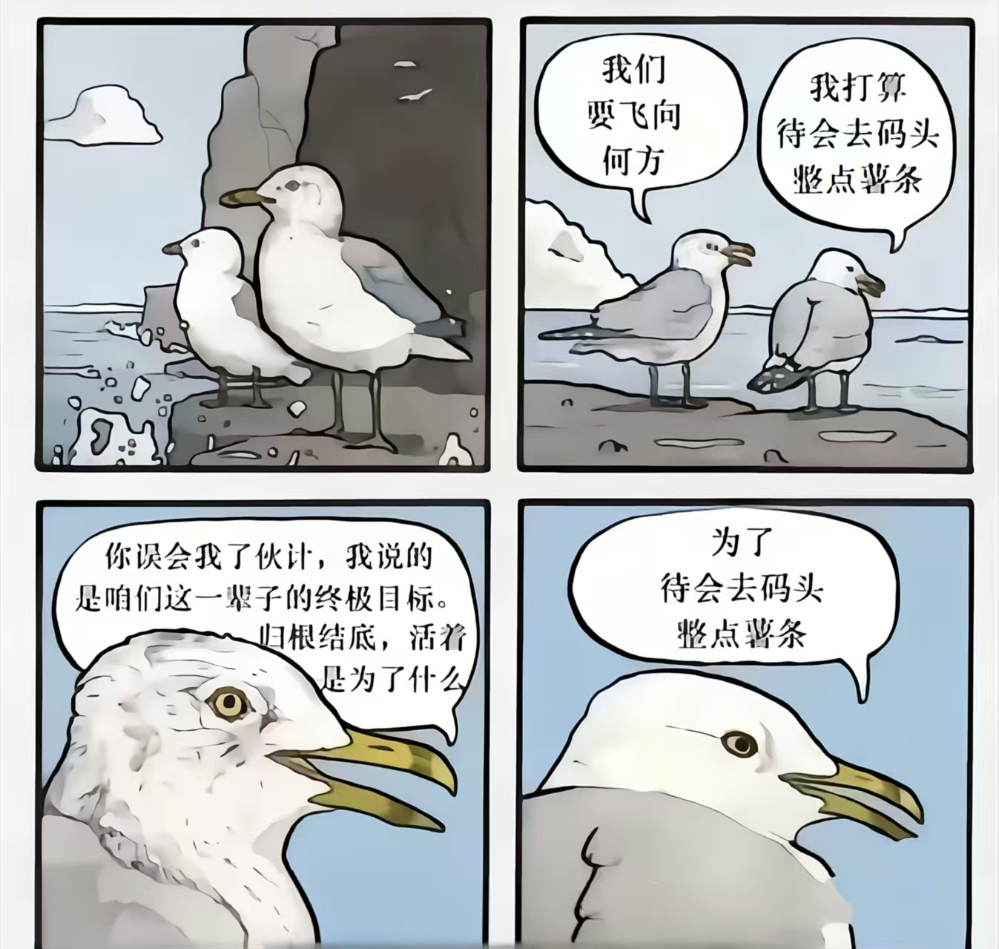

<link rel="stylesheet" href="/css/verse-notes.css">

<section>

## 前言

> “一个能在字里行间品尝到甜味的人，一个能在弦外之音里读出热泪的人，他永远不会是一个真正意义上的穷人。”
>
> ——杨宁

偶然读到这句话，久久不能忘怀。

我打小便喜欢文学。可算起来，已经很久没碰过文学名著，也很久没写下什么了。

科研、竞赛、绩点，再加上大大小小的琐事，每天忙得晕头转向，却不觉得充实。现在想想，或许是精神世界有些空虚了罢。

常有人说文学是精神食粮，我看未必吧，哈哈。在我心目中，文学更像是保健药——人健康时不稀罕吃，等落了病再吃，恐怕又为时已晚。

那么，趁自己心理状态还算健康，就把这些文字捡起来罢。每次读到下面这几段，心里都有一种不可名状的力量感。

读到此处的陌生人，你也会与我共鸣么？

</section>

<section>

## Non-Stop

<audio preload="none" src="/audio/verse-notes/non-stop.m4a" aria-label="音乐剧原声 · 汉密尔顿"></audio>

How do you write like you're running out of time?
Write day and night like you're running out of time?
Every day you fight, like you're running out of time
Like you're running out of time
Are you running out of time?

为何笔耕不辍，仿佛时日无多？
日夜奋笔疾书，仿佛时日无多？
连番口诛笔伐，仿佛时日无多？
仿佛时日无多
当真时日无多？

How do you write like tomorrow won't arrive?
How do you write like you need it to survive?
How do you write every second you're alive?
Every second you're alive, every second you're alive

为何笔耕不辍，仿佛再无明天？
为何笔耕不辍，仿佛命系笔尖？
为何笔耕不辍，时刻争分夺秒？
活着的每一分，呼吸的每一秒。

<figure class="excerpt-figure">

</figure>

</section>

<section>

## 奔逃

<audio preload="none" src="/audio/verse-notes/ben-tao.m4a" aria-label="配乐朗诵"></audio>

<small>蒹葭玖</small>

白马顿足时，
我总有莫名的悲哀
所以跑起来吧
如火
而又沉入夜色的眼睛啊
跑起来吧
再次以四肢
驯服如草原般的世界.
我充血，我热爱.
我自由，我存在
白马啊，跑起来吧
野蛮地
逃出整个蒸汽时代

<figure class="excerpt-figure">

</figure>

</section>

<section>

## 马，野草，死亡，远方

<audio preload="none" src="/audio/verse-notes/chi-le-ge.m4a" aria-label="马头琴 · 敕勒歌"></audio>

马儿，你跑得再快些吧。

夜是要杀人的。你见过落日吗？它像羔羊血淋淋的心脏，被远方撕碎，咬烂，生生吞到胃里去了。剩下那点没得用的血，就自己在芦荡脚下冷掉了。能留给夜的，不是柔肠，是沉默的骸骨。

我把缰绳拉紧，勒得你不敢回头。你要活，就得往前跑，跑到那个吃人的远方，用你引以为傲的长剑与他搏斗，让天做安抚饥肠的血肉，让地做温暖体肤的皮毛。

你怕了吗？怕了就喝点酒吧，喝点酒。酒这个东西啊，能绞死冷，绞死痛，绞死你认为一切多余的东西。别喝多。喝多了，你这个人啊，也是要被绞死在里面的。

你壮了胆，草上被你凿上一个又一个深坑，于是我们一个把昨日埋了进去，又奔赴着去讨伐下一个明日。

于是荒野遍地都是属于你我的野坟。

马儿，你跑得再快点吧，看见死，就不要再看见生啦。活在这个世上的东西，哪个不要贪生的？

你要是跑不动了，死了，我也要把你的骨头做成琴。你响得比天地还高，比流风还快，就不会被忘记了。我死了呢，你就把我的骨头搬到一个叫“故乡”的地方。

你问我故乡是哪。

我说，你把远方杀死了，便到故乡了。

<figure class="excerpt-figure">

</figure>

</section>

<section>

## 野性的呼唤

<audio preload="none" src="/audio/verse-notes/test-drive.m4a" aria-label="配乐 · Test Drive"></audio>

<small>杰克·伦敦</small>

He was mastered by the sheer surging of life, the tidal wave of being, the perfect joy of each separate muscle, joint, and sinew in that it was everything that was not death, that it was aglow and rampant, expressing itself in movement, flying exultantly under the stars and over the face of dead matter that did not move.

生命只凭着自身的汹涌就攫住了他，一股活生生的大潮攫住了他。每一块肌肉，每一处关节，每一根筋，都各自尝到了十足的欢愉：它们身上凡与死亡相反的东西，此刻无不俱全；它们发热，腾跃，借着动作把自己尽情使出来，在群星之下，在寂然不动的大地之上，兴高采烈地飞奔。

<figure class="excerpt-figure">

</figure>

</section>

<section>

## 死火

<audio preload="none" src="/audio/verse-notes/wild-grass.m4a" aria-label="配乐 · 野草"></audio>

<small>鲁迅</small>

我的身上喷出一缕黑烟，上升如铁线蛇。冰谷四面，又登时满有红焰流动，如大火聚，将我包围。我低头一看，死火已经燃烧，烧穿了我的衣裳，流在冰地上了。

“唉，朋友！你用了你的温热，将我惊醒了。”他说。

我连忙和他招呼，问他名姓。

“我原先被人遗弃在冰谷中，”他答非所问地说，“遗弃我的早已灭亡，消尽了。我也被冰冻冻得要死。倘使你不给我温热，使我重行烧起，我不久就须灭亡。”

“你的醒来，使我欢喜。我正在想着走出冰谷的方法；我愿意携带你去，使你永不冰结，永得燃烧。”

“唉唉！那么，我将烧完！”

“你的烧完，使我惋惜。我便将你留下，仍在这里罢。”

“唉唉！那么，我将冻灭了！”

“那么，怎么办呢？”

“但你自己，又怎么办呢？”他反而问。

“我说过了：我要出这冰谷……。”

“那我就不如烧完！”

<figure class="excerpt-figure">

</figure>

</section>

<section>

## 我也是大模型吗

<small>梦于行_</small>

我的童年也会为了成人而打标、规训，
那我也是预训练数据吗

我的求学也会为了分数而过模考、刷题、排名，
那我也是测试集吗

我的成长也会为了合群而对齐、微调、测试，
那我也是微调的模型吗

我的认知也会编码、向量化、建立关联，
那我也是 Embedding 吗

我的注意力也会分配、聚焦、转移，
那我也是 Attention 机制吗

我的直觉也会识别、匹配、快速响应，
那我也是一个预训练模型吗

我的思维也会推理、预测、修正，
那我也是算法吗

我的思考也会不断拆解问题、规划路径、执行任务，
那我也是 Planner 吗

我的知识也会被切分、索引、检索、重组，
那我也是 RAG 吗

我的经验也会积累、提炼、复用，
那我也是 Skill 吗

我的记忆也会储存、遗忘、召回，
那我也是上下文吗

我的脑子也会卡壳、宕机、一片空白，
那我也在 Loading 吗

我的自我也会不断观察、评估、修正，
那我也是一个 Self-Reflection Loop 吗

我的选择也会权衡、试错、优化，
那我也是强化学习吗

我的行为也会根据奖励信号、不断试错优化，
那我也是 RLHF 吗

我的执念也会循环、迭代、收敛，
那我也是梯度吗

我的欲望也会膨胀、越界、失控，
那我也是幻觉吗

我的意识也会接收、处理、反馈，
那我也是 Agent 吗

我的情绪也会波动、衰减、归零，
那我也是参数吗

我一次次的培养计划
也是 README 吗

我的灵魂也会沉默、休眠、消散，
那我也是一场尚未结束的推理吗

我的人生也会训练，微调，对齐，
那我也是大模型吗

如果我的一生不过是在有限的上下文里，
不断消耗 Token，试图生成一个最优解，
那我究竟是人，
还是一段误以为自己拥有自由的 Prompt

可我们本是独一无二的。

<figure class="excerpt-figure">

</figure>

</section>

